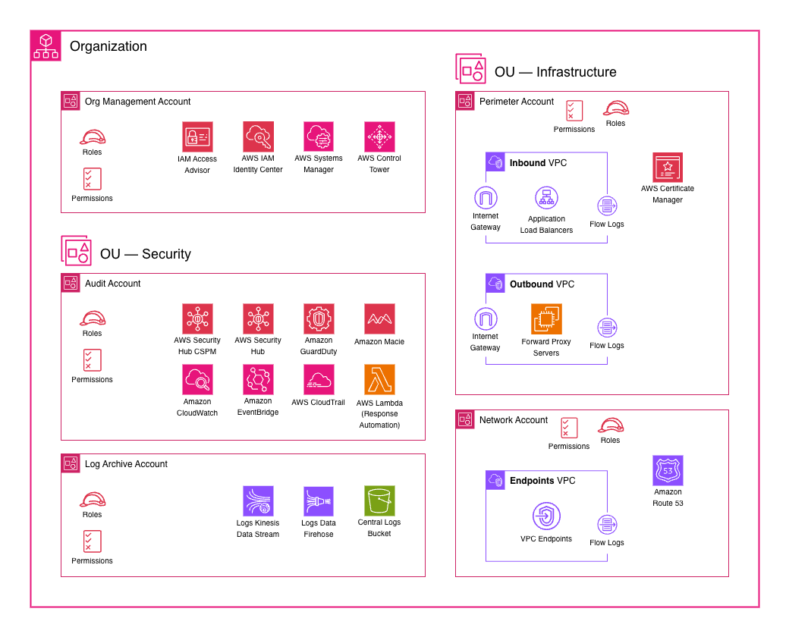
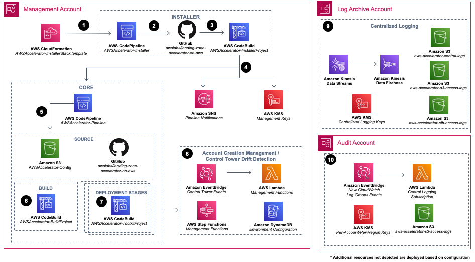

# AWS Control Tower Landing Zone

Policy-governed, secure-by-design AWS environment managed as code with the AWS Landing Zone Accelerator (LZA).

## Table of Contents

- [Overview](#overview)
- [Architecture](#architecture)
- [Repository Structure](#repository-structure)
- [Deployment Process](#deployment-process)
- [Configuration Reference](#configuration-reference)

## Overview

This repository is the declarative source of truth for the Ilysium AWS Landing Zone - a multi-account AWS cloud environment built on advanced cloud security architecture patterns. It leverages the [AWS Landing Zone Accelerator](https://docs.aws.amazon.com/solutions/landing-zone-accelerator-on-aws/), a solution that deploys a foundational set of capabilities designed to align with AWS best practices and multiple global compliance frameworks.

> [!NOTE]
> This repo contains no application logic. It is pure YAML configuration that LZA's engine (maintained separately by AWS at [awslabs/landing-zone-accelerator-on-aws](https://github.com/awslabs/landing-zone-accelerator-on-aws)) interprets to provision and manage the environment's account structure, policy guardrails, network baseline, and security services.

## Architecture

The AWS deployment follows the [AWS Security Reference Architecture](https://docs.aws.amazon.com/prescriptive-guidance/latest/security-reference-architecture/architecture.html) guidelines, which includes secure cloud baseline enforcement through Control Tower, centralized security services & logging functions, and a perimeter layer to enforce network policy on all platform ingress/egress.

## Deployment Process

Configuration changes are deployed to the Landing Zone via the `AWSAccelerator-Pipeline`, a Codepipeline workflow that watches this repository for changes and deploys resources in the desired state using Codebuild steps. The Codepipeline includes a manual approval step to allow engineers to review diffs and approve configuration changes.

## Configuration Reference

For guidance on specific service configurations, use the [Configuration Reference](https://awslabs.github.io/landing-zone-accelerator-on-aws/v1.15.0/typedocs/index.html).
